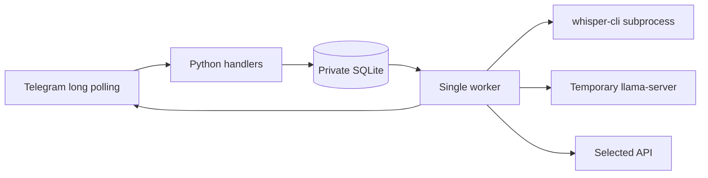

# Architecture and implementation plan

## Goal and acceptance

Replace the synchronous PyTorch/GigaChat MVP. An allowed private Telegram user sends
a voice note and receives the complete text as a quoted reply to that note. Text
actions run on demand. Users select configured local/API models. Vocabulary and
custom prompts survive restarts. Unknown users/groups cannot trigger inference.

`config.py`: operator profiles; `db.py`: settings/terms/jobs; `bot.py`: handlers,
rendering and worker; `inference.py`: subprocess lifecycle and API adapters.
SQLite is embedded, with its own file: no database server to share. Reuse the host's
Docker daemon, disk and network; do not connect unrelated apps to the bot's DB.

## Memory and concurrency

One worker serializes both model types. Whisper exits before another job starts.
Bonsai gets a temporary server on an ephemeral loopback port, terminated and reaped
in finally on success, failure, timeout or cancellation. No exported port, no
resident model. Child environments exclude bot/API keys. A file lock prevents
two local instances sharing a DB and model budget.

2 GB VPS budget: container limit 1400 MiB RAM, 2 GiB combined RAM+swap, 0.8 CPU,
one inference thread. These are ceilings, not measured RSS. Stop if sustained swap,
OOM or VPN degradation occurs. Swap is reserve, not a fast replacement for RAM.

## Data and failures

SQLite jobs: queued → running → done/error. Running jobs requeue after restart.
Bounded global admission, deduplication, retry of failed text actions. Successful
inference is saved before Telegram delivery; a send failure does not rerun it.
There is no exactly-once transaction across SQLite and Telegram. A crash mid-reply
can leave partial delivery; the result remains in the DB for operator recovery.

Audio is temporary and removed in finally; stale job directories are removed at
startup. Logs contain job IDs, elapsed time and exception types, no transcripts
or raw upstream errors. Finished jobs/results expire after seven days; vocabulary
and settings persist. Telegram/API-provider retention is outside this bot's control.
User IDs scope all terms/settings and transcript callback reads.

API endpoints/models are operator-configured, never accepted from Telegram users.
HTTPS only, TLS verification on, redirects disabled. Missing API keys hide profiles.
Configured does not mean healthy: upstream errors do not silently switch providers.
STT uses multipart `/audio/transcriptions`; LLM uses `/chat/completions`. OpenRouter
is a text provider here. Each external provider needs a separate live smoke test.

## Model choice, 2026-10-17

Whisper Large v3 Turbo Q5_0: 574,041,195 bytes of weights, still 809M parameters.
Chosen for RU speech with English technical terms. Language is selectable, vocabulary
is a short hint; no claim that quantization improves recognition.

Ternary Bonsai 2 2B (October 15): identical ternary weights in PTQ1_0 (429 MB),
PQ2_0 (517 MB), Q2_0 (547 MB). Start with PQ2_0 for cheaper unpacking. Use the pinned
PrismML runtime, no vision projector, thinking off, context 4096, output 768 tokens.
Author GPU/Apple throughput does not predict this 1 vCPU VPS. Russian editing quality
requires real user samples. Long local inputs are rejected, not silently truncated.

Sources: [release](https://prismml.com/news/bonsai-2-family),
[model card](https://huggingface.co/prism-ml/Ternary-Bonsai-2-2B-gguf),
[runtime](https://github.com/PrismML-Eng/llama.cpp),
[Whisper](https://github.com/ggml-org/whisper.cpp).

## Verification and scope

Tests cover recovery/deduplication, queue limits, user isolation, dictionary imports,
retention, UTF-16 Telegram limits, reply entities, access checks, child environments
and process cleanup. Model/Telegram checks are deployment smoke tests.
Historical code stays in Git. No old-data migration, training, automatic swap installer,
chat-based secret entry, multi-host queue or automatic paid API fallback.
